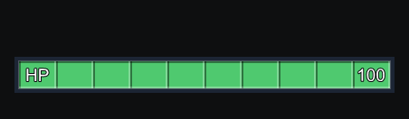
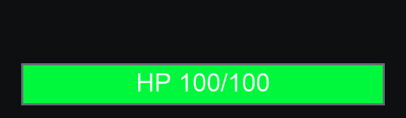

<h1 align="center">Player Status Bars</h1>

  
  
  
  

  
  
  

<strong>中文</strong>

### 预览

<table width="100%">
  <tr><th>十格样式（默认）</th><th>经典样式</th></tr>
  <tr>
    <td width="50%"></td>
    <td width="50%"></td>
  </tr>
</table>

### 常用配置

| 配置 | 默认值 | 说明 |
|:--|:--|:--|
| `Bar Style` | `Segmented` | `Segmented` 十格样式，`Classic` 经典样式 |
| `Show Infection Bars` | `true` | 主机设置，决定整个房间是否显示感染条 |
| `Max Display Distance` | `18` | 最大显示距离 |
| `Hide In Orbit` | `true` | 飞船在轨道时隐藏 |
| `Show Text` | `true` | 显示血量数字和感染百分比 |

配置保存在 `BepInEx/config/playerstatusbars.cfg`，修改后立即生效。

### 安装

通过 **r2modman / Thunderstore Mod Manager** 安装，需要 **BepInExPack 5.4.2100**。手动安装时，将 `PlayerStatusBars.dll` 放入 `BepInEx/plugins/PlayerStatusBars/`。

### 多人

- **血条**：本地安装即可使用；主机和对方也安装时，血量更准确。
- **感染条**：需要主机安装 Player Status Bars 并开启 `Show Infection Bars`。

### 兼容

- [LC_Chinese_Project](https://thunderstore.io/c/lethal-company/p/Aueser/LC_Chinese_Project/)：自动使用中文配置与说明。
- [LethalConfig](https://thunderstore.io/c/lethal-company/p/AinaVT/LethalConfig/)：在游戏内修改配置，立即生效。

遇到问题请在 [Issues](https://github.com/Auuueser/Player-Status-Bars/issues) 附上复现步骤、模组列表及 `BepInEx/LogOutput.log`。项目采用 [GPL-3.0](LICENSE) 许可。

<strong>English</strong>

### Preview

<table width="100%">
  <tr><th>Segmented (default)</th><th>Classic</th></tr>
  <tr>
    <td width="50%"></td>
    <td width="50%"></td>
  </tr>
</table>

### Common settings

| Setting | Default | Description |
|:--|:--|:--|
| `Bar Style` | `Segmented` | `Segmented` ten-cell bars, `Classic` original style |
| `Show Infection Bars` | `true` | Host setting that decides whether the room shows infection bars |
| `Max Display Distance` | `18` | Maximum display distance |
| `Hide In Orbit` | `true` | Hide while the ship is in orbit |
| `Show Text` | `true` | Show health numbers and infection percentage |

Settings are saved to `BepInEx/config/playerstatusbars.cfg` and apply immediately.

### Installation

Install through **r2modman / Thunderstore Mod Manager**. Requires **BepInExPack 5.4.2100**. For a manual install, place `PlayerStatusBars.dll` in `BepInEx/plugins/PlayerStatusBars/`.

### Multiplayer

- **Health bars**: work with a local install; more accurate when the host and that player install it too.
- **Infection bars**: require the host to install Player Status Bars and enable `Show Infection Bars`.

### Compatibility

- [LC_Chinese_Project](https://thunderstore.io/c/lethal-company/p/Aueser/LC_Chinese_Project/): Chinese setting names and descriptions are used automatically.
- [LethalConfig](https://thunderstore.io/c/lethal-company/p/AinaVT/LethalConfig/): change settings in game; changes apply immediately.

Report problems through [Issues](https://github.com/Auuueser/Player-Status-Bars/issues), including reproduction steps, your mod list and `BepInEx/LogOutput.log`. Licensed under [GPL-3.0](LICENSE).

